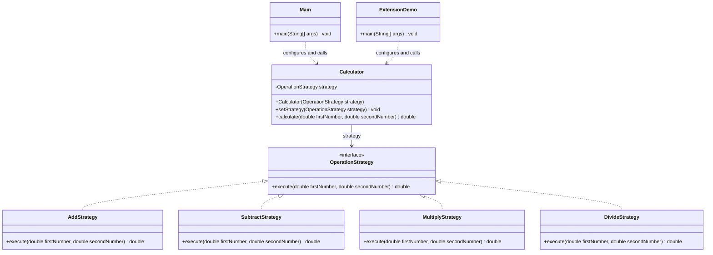

# Strategy Pattern

Madi Talgat  
SE-2537

## 1. Introduction

This project implements Option B, a console calculator in Java 17 [1]. The algorithm family contains addition, subtraction, and multiplication. Division is a separate extension example. Each algorithm implements OperationStrategy. Calculator stores this interface and delegates calculation to the selected object. This follows Strategy: a client chooses one of several interchangeable algorithms [2]. Main uses Scanner and a map to select an operation. It creates one Calculator before the menu loop, then calls setStrategy for each valid choice.

## 2. UML class diagram



Main is the interactive Client; ExtensionDemo is a second Client. The solid arrow is Calculator's reference to OperationStrategy. Dashed lines with hollow triangles show interface implementation; dashed open arrows show client dependencies. Main creates the three base strategies. ExtensionDemo also selects DivideStrategy.

Runtime example: ExtensionDemo uses the same Calculator for 12 and 4. Changing its strategy produces 16.0, 8.0, 48.0, and 3.0. The project was compiled with Java 17 and these results were checked. Invalid menu choices and invalid number input were also checked.

## 3. Clean Code

Each code excerpt is explained immediately below it.

### 3.1 Replace algorithm conditions with polymorphism

Calculator.java

```java
public double calculate(double firstNumber, double secondNumber) {
    return strategy.execute(firstNumber, secondNumber);
}
```

Calculator calls the interface method. The selected object decides which arithmetic operation runs, so this method has no if or switch for strategy types. In Main, strategies.get(choice) selects the object. Its remaining conditions only handle validation and exiting.

### 3.2 Use meaningful names

OperationStrategy.java

```java
public interface OperationStrategy {
    double execute(double firstNumber, double secondNumber);
}
```

OperationStrategy describes the role, while firstNumber and secondNumber describe the operands. AddStrategy, SubtractStrategy, and MultiplyStrategy state their purpose directly. Clear names make the code understandable without comments or names such as Strategy1 and x.

### 3.3 Give each class one responsibility

MultiplyStrategy.java

```java
public class MultiplyStrategy implements OperationStrategy {
    public double execute(double firstNumber, double secondNumber) {
        return firstNumber * secondNumber;
    }
}
```

MultiplyStrategy only multiplies two numbers. It does not read input, print a menu, or choose the next operation. Input and output belong to Main; holding and using the selected algorithm belongs to Calculator. A change to multiplication is therefore isolated.

### 3.4 Keep the Context independent of concrete algorithms

Calculator.java

```java
private OperationStrategy strategy;

public Calculator(OperationStrategy strategy) {
    this.strategy = strategy;
}

public void setStrategy(OperationStrategy strategy) {
    this.strategy = strategy;
}
```

The private field, constructor, and setter all use the interface. Calculator never creates AddStrategy or another concrete algorithm. The client supplies a valid strategy and can replace that reference at runtime without changing the Calculator object.

### 3.5 Extend behavior without changing existing classes

DivideStrategy.java

```java
public class DivideStrategy implements OperationStrategy {
    public double execute(double firstNumber, double secondNumber) {
        if (secondNumber == 0) {
            throw new IllegalArgumentException("Cannot divide by zero.");
        }

        return firstNumber / secondNumber;
    }
}
```

ExtensionDemo.java (excerpt)

```java
calculator.setStrategy(new DivideStrategy());
System.out.println("12 / 4 = " + calculator.calculate(12, 4));
```

Adding DivideStrategy and the new ExtensionDemo client introduces division without editing Calculator, the three original strategies, or Main. The zero check belongs to the division algorithm; it is not strategy selection. Adding division to the existing menu would require updating Main's menu and map, while the Context would remain unchanged.

## 4. Strategy vs. State

Strategy fits this calculator because the client explicitly chooses an arithmetic algorithm. AddStrategy does not change itself into MultiplyStrategy, and the operations do not define a lifecycle. State models behavior that depends on an object's current state, with transition rules, such as an order moving from New to Paid to Shipped [3]. Both patterns can delegate through an interface; their purpose differs. Here the selected algorithm changes, so Strategy is appropriate.

## 5. Conclusion

The calculator can switch algorithms during one run and gain a new algorithm without changing its calculation method. The tradeoff is more files: this example has one interface and seven classes, including the extra strategy and demo client. For a tiny fixed calculator, this structure is more work than a few arithmetic branches. It is useful here because algorithm replacement and extension are explicit requirements. Calculations use double and follow normal floating-point rounding.

## 6. GitHub repository

https://github.com/Feruum/sdp67

### Sources and assistance

1. AITU. Assignment #5 - Strategy Pattern, 2026-2027. Supplied assignment instructions.
2. Refactoring.Guru. [Strategy](https://refactoring.guru/design-patterns/strategy). Accessed 25 October 2026.
3. Refactoring.Guru. [State](https://refactoring.guru/design-patterns/state). Accessed 25 October 2026.
4. OpenAI ChatGPT, 25 October 2026. Assistance with the example implementation and report draft.
